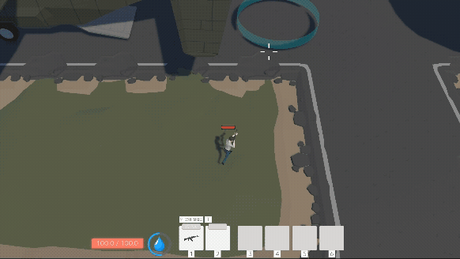
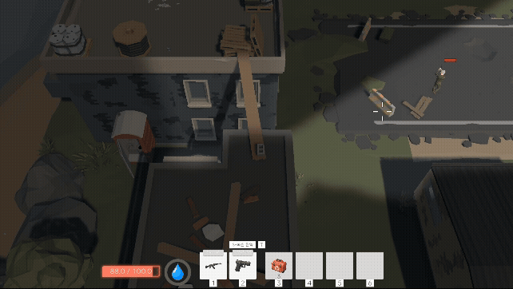
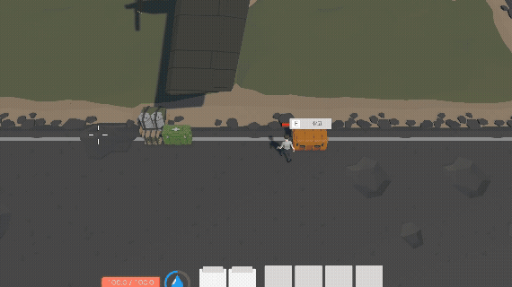
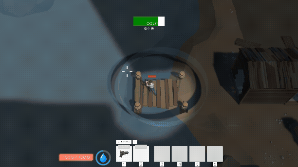

# Steel Hunter — Escape from Duckov 시스템 모작  

> Escape from Duckov의 탐색·전투·루팅·탈출 흐름을 Unity로 구현한 탑다운 슈팅 포트폴리오 프로젝트입니다.

격납고에서 장비를 준비하고, 전장에서 전리품을 수집한 뒤 살아서 귀환하는 플레이를 구현했습니다. **씬 전환 시 아이템 상태 유지**, **아이템 데이터와 실제 객체의 분리**, **Behavior Tree 기반 AI**, **거래와 장비 변경의 일관성**에 중점을 두었습니다.

---

## 목차

- [개요](#개요)
- [기술 스택](#기술-스택)
- [구현 내용](#구현-내용)
- [핵심 구현](#핵심-구현)
- [트러블슈팅](#트러블슈팅)
- [조작법](#조작법)
- [에셋 및 참고 자료](#에셋-및-참고-자료)

---

## 개요

| 항목    | 내용                            |
| ----- | ----------------------------- |
| 프로젝트  | Steel Hunter                  |
| 참고 게임 | Escape from Duckov            |
| 장르    | 탑다운 3D 슈팅 / 익스트랙션             |
| 엔진    | Unity 6000.3.7f1 / URP 17.3.0 |
| 언어    | C#                            |
| 플랫폼   | PC                            |
| 개발 기간 | 2026.09.14 ~ 2026.10.15       |
| 개발 인원 | 1명                            |

### 프로젝트 소개

- Escape from Duckov의 핵심 플레이 흐름을 참고하여 캐릭터 조작, 전투, 인벤토리, 적 AI, 상점, 탈출 시스템을 설계 및 구현
- 모델, UI, 사운드에는 별도의 외부 에셋을 사용(아이템 아이콘은 생성형 AI로 생성)
- 특히 **적 AI**와 **전투 시스템** 구현에 집중

### 게임 진행

1. **출격 준비**: 격납고의 보관함과 상점에서 무기, 탄약, 장비를 준비
2. **탐색과 교전**: 전장에 진입해 주변을 탐색하고 적과 교전
3. **루팅과 관리**: 전리품을 수집하고 탄약과 소모품을 관리
4. **탈출과 귀환**: 탈출 구역에서 일정 시간 머무르거나 보스를 처치하면 소지품을 유지한 채 귀환

---

## 기술 스택

| 기술                               | 활용                      |
| -------------------------------- | ----------------------- |
| Unity / C#                       | 캐릭터, 전투, 아이템, AI 구현     |
| Universal Render Pipeline 17.3.0 | 렌더링 및 포그오브워 합성          |
| Input System 1.18.0              | 이동·조준·사격 등 플레이어 입력      |
| AI Navigation 2.0.9              | 적의 NavMesh 기반 경로 탐색     |
| Cinemachine 3.1.7                | 카메라 구성                  |
| DOTween                          | UI 및 연출 애니메이션           |
| ScriptableObject                 | 아이템·총기·탄약·부착물·AI 설정 데이터 |
| Git, GitHub                      | 소스 코드 버전 관리             |

---

## 구현 내용

### 캐릭터
- `ICharacterCommands`를 통해 플레이어와 적 AI의 이동·조준·사격 명령 공통화
- `CharacterMover`의 CharacterController 기반 이동, `PlayerAimResolver`의 Raycast 및 SphereCast 기반 마우스 조준

### 전투
- `BulletProjectile`에서 탄환의 이동 구간을 SphereCast로 검사하고, 가장 가까운 유효 충돌을 판정
- 방어 등급, 탄약 관통 등급, 치명타를 반영한 피해량 계산

### 무기
- `FirearmData`로 무기 기본 정보를 정의하고, `WeaponInstance`로 잔탄·장전된 탄약 종류를 관리
- 주무기·보조무기 전환, 재장전 및 탄약 종류 선택
- `WeaponStatCalculator`에서 최종 무기 능력치 계산

### 인벤토리 / 장비 시스템
- `ItemData` 기반의 아이템 정의와 `ItemStack` 기반 수량·장비 고유 ID 관리
- 가방 슬롯 및 무게 검사, 장비 장착 및 퀵슬롯 아이템 사용
- `InventoryPresenter`와 `InventoryView`를 분리하여 사용자 입력과 인벤토리 변경 사항을 화면에 연결

### 보관함 / 루팅 시스템
- `LootContainer` 기반 전리품 관리 및 인벤토리로 아이템 이동
- `CharacterLootDropper`를 통한 적 캐릭터 사망 시 전리품 드롭
- `StashInventory`와 `HangarStash`를 이용한 격납고 보관함 관리

### 상점 시스템
- `ShopService`에서 구매·판매 처리, `ShopState`와 `ShopWallet`에서 재고·재화 관리
- 재고·재화·가방 공간·무게 검사 후 전체 상태를 반영하고 UI 변경 알림 전달

### 시야 / Fog of War
- `FieldOfView`에서 시야 반경·각도와 장애물 검사를 바탕으로 시야 메시 생성
- 전용 카메라와 RenderTexture를 이용한 시야 영역 렌더링 및 포그오브워 합성
- `FogOfWarController`에서 블러와 이전 프레임의 시야 결과와 현재 결과 사이의 보간을 적용해 시야 경계 변화 완화

### 적 AI
- `EnemyPerception`의 시야·소음 감지와 `EnemyBlackboard`의 마지막 감지 위치 등 기억 정보 관리
- `EnemyCharacterBrain`의 Behavior Tree 기반 순찰·조사·수색·전투·복귀·사망 행동 선택
- `EnemyActionRunner`와 개별 Action 클래스로 행동 선택과 실행 분리
- `CharacterNavigator`에서 NavMesh 경로 탐색

### 씬 전환 / 상태 유지
- `InventorySession`에서 씬 간 소지품·보관함·상점 상태 유지
- `PlayerInventorySnapshot`으로 인벤토리·장비·활성 무기·퀵슬롯 연결을 캡처하고 다음 씬에서 복원
- 깊은 복사와 슬롯 용량·장비 ID 검증 후 상태를 복원하고 UI 갱신

### 탈출 / 결과
- `EscapeZone`에서 탈출 구역 체류 시간을 확인하고 탈출 진행 상태 표시
- `BattleFlowController`를 통한 출격 결과 처리
- 탈출 성공·보스 처치 시 소지품 유지, 사망·출격 포기 시 소지품 제거
- 결과 확정 후 상태를 전환하여 동일 출격의 중복 정산 방지

### UI / 전투 피드백
- 상태 HUD, 인벤토리·상점·전투 결과 화면 및 탈출 진행 UI
- 크로스헤어, 체력바, 피격 피해량 표시를 통한 전투 정보 전달
- `PoolManager`를 이용해 피격 데미지 텍스트 등에 오브젝트 풀링 적용

---

## 핵심 구현

### 플레이어·AI 공통 캐릭터 제어와 전투

플레이어 입력과 AI 행동이 `ICharacterCommands`를 통해 같은 이동·조준·사격 기능을 사용하도록 구성했습니다. `CharacterCommandReceiver`가 생존 상태 등 실행 조건을 확인하고 기능별 컴포넌트에 요청을 전달하여 조작 규칙의 중복을 줄였습니다.

- `CharacterGun`은 `IWeaponProvider`와 `IAmmoSource`로 무기·예비 탄약을 조회하여 플레이어와 적의 발사·재장전 로직을 공통화
- 재장전 중 무기가 변경되면 재장전을 취소하고, 완료 시 필요한 수량만큼 예비 탄약 소비
- 탄환의 물리 프레임별 이동 구간을 SphereCast로 검사하고 가장 가까운 충돌 대상에 피해 적용

### 행동 트리 기반 적 AI

**행동 선택과 실행을 분리**하고, 감지 정보를 개체별 `EnemyBlackboard`에 모아 판단과 행동이 같은 정보를 참조하도록 구성했습니다.

- `Selector`와 `Sequence`로 조건과 우선순위를 평가해 사망·전투·수색·조사·복귀·순찰 행동 선택
- 개별 행동을 `IEnemyAction`으로 구현하고 `Enter·Tick·Exit`로 생명주기 통일
- `EnemyActionRunner`는 선택된 행동이 같으면 유지하고, 달라지면 기존 행동 종료 후 새 행동 시작
- 현재 시야와 과거 목격·청음 정보를 구분하여 적을 놓친 뒤에도 마지막 목격 위치를 기준으로 수색

### 인벤토리·장비 상태와 UI 분리

아이템의 공통 정의는 ScriptableObject에, 수량과 개별 장비 상태는 `ItemStack`·`WeaponInstance`에 저장했습니다. 같은 종류의 무기도 고유 ID로 구분하여 가방과 장착 슬롯 사이를 이동할 때 각 무기의 장전 상태를 유지합니다.

- 슬롯 순서와 빈칸, 동일 아이템의 여러 스택을 유지하기 위해 배열 기반 인벤토리 사용
- MVP 구조로 게임 규칙 검증은 Model, 화면 표시와 입력 전달은 View, 요청 처리와 갱신 연결은 Presenter가 담당
- 장비와 인벤토리 상태를 모두 반영한 뒤 변경 이벤트를 발행하여 UI와 무기 로직이 최종 상태를 참조하도록 처리

### 씬 전환 시 소지품·창고 상태 유지

`PlayerInventorySnapshot`에 인벤토리·장착 장비·활성 무기 슬롯·퀵슬롯 연결을 함께 저장합니다. 아이템과 무기 상태를 별도 객체로 복사하되 **장비의 고유 ID는 유지**하여 저장 당시의 상태와 장비 식별 정보를 보존합니다.

- `InventorySession`에서 출격 결과에 따른 상태 처리를 담당하여 UI와 개별 아이템에서 진행 규칙 분리
- 탈출 성공·승리 시 소지품과 장비 유지
- 사망 시 소지품과 장착 장비를 제거하고, 별도로 관리하는 창고 아이템은 보존

---

## 트러블슈팅

### 경사 지형에서 이동 불가·떨림

- **문제**: 완만한 경사를 오르내리지 못하거나, 특정 지형을 향해 계속 이동할 때 캐릭터가 떨리는 현상 발생
- **원인**: Rigidbody에 힘을 가하는 이동 방식에서 경사를 오르는 힘이 부족했고, 일부 외부 맵 에셋의 콜라이더가 시각적인 지형과 불일치
- **해결**: CharacterController 기반으로 전환해 이동 가능한 경사를 명시하고 중력·접지·가속·감속을 직접 처리. 일부 맵 에셋 위치도 조정
- **결과**: 완만한 경사를 자연스럽게 이동하고, 경사 하단에서 이동을 시도할 때 발생하던 떨림 해결

### 고저차에 따른 탄환 빗나감

- **문제**: 높거나 낮은 위치의 적을 커서로 조준해도 탄환이 적의 위아래로 지나가는 현상 발생
- **원인**: 마우스 위치를 일정 높이의 평면에 투영하여 조준점과 적의 실제 높이가 불일치
- **해결**: 커서 방향에서 탐색한 적의 Collider 중심을 조준점으로 사용하고, 총구에서 해당 지점으로 발사. 거리·높이 차이·가려짐 조건으로 보정 대상 제한
- **결과**: 적의 실제 높이를 발사 방향에 반영하여 명중하도록 수정. 유효한 대상이 없으면 기존 조준 방식 유지

---

## 조작법

| 입력         | 동작            |
| ---------- | ------------- |
| WASD / 방향키 | 카메라 기준 이동     |
| 마우스 이동     | 조준 방향 지정      |
| 마우스 왼쪽 버튼  | 발사            |
| 마우스 오른쪽 버튼 | 조준 모드         |
| Left Shift | 달리기           |
| R          | 재장전           |
| T          | 탄약 종류 선택      |
| 1 / 2      | 주무기 / 보조무기 선택 |
| 3 ~ 6      | 퀵슬롯 아이템 사용    |
| E          | 상호작용          |
| Tab        | 인벤토리 열기 / 닫기  |
| Esc        | 열린 인벤토리 닫기    |

---

## 에셋 및 참고 자료

- 게임 플레이 시스템은 **Escape from Duckov**를 참고
- 게임 시스템 구현은 직접 진행했으며, 모델·UI·사운드에는 외부 에셋을 사용

| 분류    | 에셋                             | 출처                                                                                                                        |
| ----- | ------------------------------ | ------------------------------------------------------------------------------------------------------------------------- |
| 모델    | `POLYGON - Battle Royale Pack` | [Asset Store](https://assetstore.unity.com/packages/3d/environments/urban/polygon-battle-royale-pack-art-by-synty-128513) |
| 애니메이션 | `캐릭터 이동·전투 애니메이션`              | [Mixamo](https://www.mixamo.com/)                                                                                         |
| UI    | `Shift - Complete Sci-Fi UI`   | [Asset Store](https://assetstore.unity.com/packages/2d/gui/shift-complete-sci-fi-ui-157943)                               |
| UI    | `Simple Spinner`               | [Asset Store](https://assetstore.unity.com/packages/2d/gui/icons/simple-spinner-progress-indicators-for-ui-237500)        |
| UI    | Crosshair Pack                 | [itch.io](https://kenney-assets.itch.io/crosshair-pack)                                                                   |
| 사운드   | `Footsteps - Essentials`       | [Asset Store](https://assetstore.unity.com/packages/audio/sound-fx/foley/footsteps-essentials-189879)                     |
| 사운드   | `Sci-Fi Sounds`                | [Asset Store](https://assetstore.unity.com/packages/audio/sound-fx/sci-fi-sounds-22391)                                   |
| 폰트    | `NEXON Lv.1 Gothic`            | [공식 사이트](https://brand.nexon.com/ko/ci-brand-guidelines/typeface#section-lv1-gothic)                                      |
| 개발 도구 | `DOTween`                      | [Asset Store](https://assetstore.unity.com/packages/tools/animation/dotween-hotween-v2-27676)                             |

